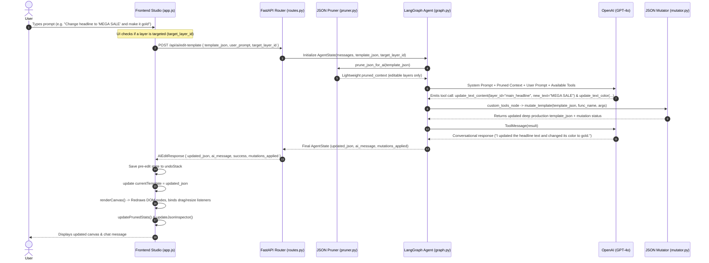

# AI Template Editor — Comprehensive End-to-End Technical Working Guide

This document provides a detailed, step-by-step technical explanation of how the **AI Template Editor** works from end to end. It covers the entire lifecycle: system architecture, API requests, token-optimized context pruning, LangGraph agentic tool execution, safe JSON mutation logic, and interactive DOM canvas rendering.

---

## 1. High-Level System Architecture

The AI Template Editor is built on a hybrid architecture combining a **FastAPI backend**, a **LangGraph agentic state graph**, and a **vanilla JavaScript glassmorphic frontend canvas studio**.

```
┌──────────────────────────────────────────────────────────────────────────────────┐
│                                 FRONTEND CANVAS                                   │
│  - Interactive Studio (index.html, style.css, app.js)                            │
│  - Live Canvas Renderer (DOM Nodes, Drag & Drop, Resize Handles, Inline Edit)    │
│  - Chat Interface & Selected Layer Targeting System                              │
└───────────────────────────────┬──────────────────────────────────────────────────┘
                                │ HTTP Requests (REST API)
                                ▼
┌──────────────────────────────────────────────────────────────────────────────────┐
│                                FASTAPI BACKEND                                   │
│  - Main App (`app/main.py`) & API Router (`app/api/routes.py`)                  │
│  - Pydantic Request & Response Schemas (`app/models/schemas.py`)                 │
└───────────────────────────────┬──────────────────────────────────────────────────┘
                                │
                                ▼
┌──────────────────────────────────────────────────────────────────────────────────┐
│                         LANGGRAPH AGENT WORKFLOW ENGINE                          │
│  - Context Pruner (`app/services/pruner.py`): Reduces token payload ~70-80%       │
│  - LangGraph StateGraph (`app/services/graph.py`): Re-evaluates prompt & tools    │
│  - Custom Tool Interceptor (`custom_tools_node`): Intercepts LLM tool calls       │
│  - Safe JSON Mutator (`app/services/mutator.py`): Deep property mutation engine  │
└───────────────────────────────┬──────────────────────────────────────────────────┘
                                │ Tool Calling / LLM Invocation
                                ▼
┌──────────────────────────────────────────────────────────────────────────────────┐
│                               OPENAI LLM (GPT-4o)                                │
│  - Interprets spatial language ("at the bottom", "below headline")               │
│  - Emits structured tool calls (`update_text_content`, `add_new_text`, etc.)    │
└──────────────────────────────────────────────────────────────────────────────────┘
```

---

## 2. End-to-End Architectural Flow Diagram



---

## 3. Step-by-Step Execution Lifecycle with Concrete Examples

### Step 1: Frontend Initialization & Template Loading
1. **DOM Load**: When `static/index.html` loads, `app.js` runs `init()`.
2. **Backend Health Check**: Calls `GET /health` to verify server status and check if OpenAI API key is active.
3. **Template Payload Loading**:
   - `app.js` fetches `/tests/custom_template.json` (or uses built-in presets like `ecommerce_banner`, `social_post`, `event_flyer`).
   - Standardizes top-level array-wrapped structures: `[ { "layers": { "ROOT": ..., "layer_id": ... } } ]`.
4. **Pruning Metric Calculation**:
   - Calls `POST /api/ai/prune-template` with `currentTemplate`.
   - Calculates original JSON byte size vs pruned JSON byte size and displays payload token savings percentage (typically **70%–85% reduction**).

---

### Step 2: User Prompt & Layer Targeting
Users can interact in two ways:
1. **Global Prompt**: Typing instructions into the chat box without selecting a layer (e.g., *"Make background dark blue and add a shop button at the bottom"*).
2. **Targeted Layer Prompt**: Clicking any canvas element sets `targetLayerId = "bfa48ce6-b765-4acc-847b-a35574e6a1ae"` and displays a targeting badge in the UI.

When the user submits the prompt, `handlePromptSubmit()` constructs the payload:

```json
{
  "template_json": [
    {
      "layers": {
        "ROOT": { "type": "bgImage", "props": { ... } },
        "main_headline": {
          "type": { "resolvedName": "TextLayer" },
          "props": {
            "doc": {
              "type": "doc",
              "content": [
                {
                  "type": "paragraph",
                  "attrs": { "color": "rgb(109, 172, 206)", "fontSize": "44px" },
                  "content": [{ "type": "text", "text": "OLD HEADLINE TEXT" }]
                }
              ]
            },
            "position": { "x": 60, "y": 80 }
          }
        }
      }
    }
  ],
  "user_prompt": "Change headline text to 'SUPER SUMMER SALE' and color to gold",
  "target_layer_id": "main_headline"
}
```

---

### Step 3: Backend API Handler (`app/api/routes.py`)
1. Route `/api/ai/edit-template` receives the `AIEditRequest` Pydantic model.
2. Validates `template_json` and ensures `user_prompt` is non-empty.
3. Instantiates `initial_state`:
   ```python
   initial_state = {
       "messages": [HumanMessage(content=request.user_prompt)],
       "template_json": request.template_json,
       "mutations_applied": [],
       "target_layer_id": request.target_layer_id,
   }
   ```
4. Invokes the LangGraph StateGraph instance via `await graph.ainvoke(initial_state)`.

---

### Step 4: Token-Optimized Context Pruning (`app/services/pruner.py`)
Before passing the template to the LLM, `prune_json_for_ai()` converts heavy production JSON (which contains raw SVG strings, image URLs, matrix transforms, and font metadata) into a token-lean JSON schema.

#### Example Pruner Transformation:
**Raw Heavy Input Layer:**
```json
"main_headline": {
  "type": { "resolvedName": "TextLayer", "type": "customText", "replacableText": "OLD HEADLINE TEXT" },
  "child": [],
  "props": {
    "doc": {
      "type": "doc",
      "content": [{
        "type": "paragraph",
        "attrs": { "color": "rgb(109, 172, 206)", "fontSize": "44px", "fontFamily": "Roboto", "lineHeight": "1.2" },
        "content": [{ "type": "text", "text": "OLD HEADLINE TEXT" }]
      }]
    },
    "fonts": [{ "family": "Roboto", "url": "https://fonts.gstatic.com/..." }],
    "position": { "x": 60, "y": 80 },
    "boxSize": { "x": 60, "y": 80, "width": 680, "height": 100 }
  },
  "parent": "ROOT"
}
```

**Pruned AI-Friendly Output Context:**
```json
{
  "layers": {
    "main_headline": {
      "id": "main_headline",
      "type": "TextLayer",
      "ai_label": "TextLayer (main_headline)",
      "editable": {
        "text": "OLD HEADLINE TEXT",
        "color": "rgb(109, 172, 206)",
        "fontSize": "44px"
      }
    }
  }
}
```

---

### Step 5: Agentic Reasoning & Tool Calling (`app/services/graph.py`)
The LangGraph node `create_agent_node` injects the pruned context and design intelligence rules into the system prompt:

```text
You are an expert AI design assistant for a template editor.
Canvas Dimensions: Width=800px, Height=450px.
Below is the lightweight, editable structure of the user's template:
{
  "layers": { ... }
}

🎯 TARGETED LAYER CONSTRAINTS:
The user has EXPLICITLY TARGETED the single layer ID: 'main_headline'.
You MUST restrict all layer mutations ONLY to layer 'main_headline'.

Instructions & Design Intelligence:
1. Calculate appropriate pixel coordinates (x, y) based on canvas size and existing layers when positioning elements.
2. Available tools:
   - update_text_content(layer_id, new_text)
   - update_text_color(layer_id, new_color)
   - update_image_url(layer_id, new_image_url)
   - add_new_text(text, x, y, font_size, color)
   - move_layer(layer_id, x, y)
   - delete_layer(layer_id)
```

#### LLM Execution & Decision:
The LLM evaluates the prompt and decides to invoke two tools:
1. `update_text_content(layer_id="main_headline", new_text="SUPER SUMMER SALE")`
2. `update_text_color(layer_id="main_headline", new_color="#f59e0b")`

---

### Step 6: Safe Production JSON Mutation (`app/services/mutator.py`)
`custom_tools_node` intercepts the LLM tool calls and executes `mutate_template()`. It performs deep property updates on a isolated copy (`copy.deepcopy`) of the production JSON.

1. **Text Content Update (`apply_text_update`)**:
   - Updates top-level `type.replacableText = "SUPER SUMMER SALE"`.
   - Traverses deep TipTap doc node `props.doc.content[0].content[0].text = "SUPER SUMMER SALE"`.
   - Collapses extra spans to prevent fragmented rendering.
2. **Color Update (`apply_color_update`)**:
   - Converts color name or hex via `color_utils.py` (`normalize_color("#f59e0b")` -> `#f59e0b` or `rgb(...)`).
   - Updates `props.doc.content[0].attrs.color = "#f59e0b"`.
   - Updates `props.colors[0] = "#f59e0b"`.
3. **New Layer Addition (`apply_add_text_layer`)**:
   - Creates new LidoJS `TextLayer` dict with TipTap doc structure.
   - Appends `layer_id` to `ROOT` layer's `child` array (`layers["ROOT"]["child"].append(new_layer_id)`) so LidoJS renderers display it.

---

### Step 7: API Response Delivery
The backend returns `AIEditResponse`:

```json
{
  "updated_json": [ ... mutated production JSON ... ],
  "ai_message": "I updated the text of 'main_headline' to 'SUPER SUMMER SALE' and set its color to gold (#f59e0b).",
  "success": true,
  "mutations_applied": [
    "update_text_content: {'layer_id': 'main_headline', 'new_text': 'SUPER SUMMER SALE'}",
    "update_text_color: {'layer_id': 'main_headline', 'new_color': '#f59e0b'}"
  ]
}
```

---

### Step 8: Frontend Canvas & DOM Rendering (`static/js/app.js`)
Upon receiving the API response:
1. **History Tracking**: `saveHistoryState()` pushes `currentTemplate` into `undoStack` (supports up to 30 undo steps).
2. **State Update**: Sets `currentTemplate = response.updated_json`.
3. **Canvas DOM Redraw (`renderCanvas()`)**:
   - Clears existing DOM nodes in `#canvas-frame`.
   - Sets canvas width, height, and background color based on `rootData.canvas`.
   - **ROOT Background Image Handling**: If `layers["ROOT"].props.image.url` exists, creates `#render-layer-ROOT-BG` with `background-image` style. Binds drag-and-drop & resize handles.
   - **Layer Loop**: Iterates through each layer in `layers`:
     - Resolves `position.x`, `position.y`, `boxSize.width`, `boxSize.height`.
     - Calculates final scaled font size: `finalFontSize = fontSize * scale`.
     - Sets text content, font family, font weight, color, alignment, text transform.
     - Appends created DOM element `div.canvas-layer` to `#canvas-frame`.
4. **Interactive Listener Attachment**:
   - **Mouse Drag-and-Drop (`makeLayerDraggable`)**: Binds `mousedown`, `mousemove`, `mouseup` to update `layer.props.position.x/y` dynamically while dragging across the canvas.
   - **Interactive Resize Handles (`attachResizeHandles`)**: Attaches bottom-right handle `.resize-handle.se` to dynamically scale width/height.
   - **Single-Click Selection (`renderSelectedLayerInspector`)**: Opens the bottom inspector bar with live input controls (text input, color picker, font size input, width/height inputs, delete button).
   - **Double-Click Inline Editing (`enableInlineTextEdit`)**: Sets `contentEditable="true"`, allowing users to type directly on the visual canvas. On `blur` or <kbd>Enter</kbd>, updates the underlying JSON object model directly.
5. **UI Component Updates**:
   - Appends assistant response to the live Chat Stream (`appendChatMessage`).
   - Updates token savings stats (`updatePrunedStats()`).
   - Refreshes JSON code viewer (`updateJsonInspector()`).
   - Appends entry to the Mutations Audit Timeline (`updateMutationsTab()`).

---

## 4. Summary of API Endpoints

| Endpoint | Method | Input Schema | Output Schema | Purpose |
| :--- | :--- | :--- | :--- | :--- |
| `/health` | `GET` | None | `HealthResponse` | Operational status check & LLM key configuration check |
| `/api/ai/prune-template` | `POST` | `PruneRequest` | `PruneResponse` | Returns lightweight pruned JSON context and layer count |
| `/api/ai/edit-template` | `POST` | `AIEditRequest` | `AIEditResponse` | Primary agentic endpoint executing LangGraph tool loop & deep mutation |

---

## 5. Keyboard Shortcuts & User Controls

- <kbd>Ctrl</kbd> + <kbd>Z</kbd> / <kbd>Cmd</kbd> + <kbd>Z</kbd>: **Undo** last change (restores previous canvas state & JSON).
- <kbd>Ctrl</kbd> + <kbd>Y</kbd> / <kbd>Cmd</kbd> + <kbd>Y</kbd> or <kbd>Cmd</kbd> + <kbd>Shift</kbd> + <kbd>Z</kbd>: **Redo** previously undone change.
- <kbd>Delete</kbd> / <kbd>Backspace</kbd>: **Delete** currently selected canvas layer.
- **Double Click Text**: Activate **inline text editing** directly on the visual canvas.
- **Inspect Mode Toggle**: Outlines all editable bounding boxes for layout debugging.
